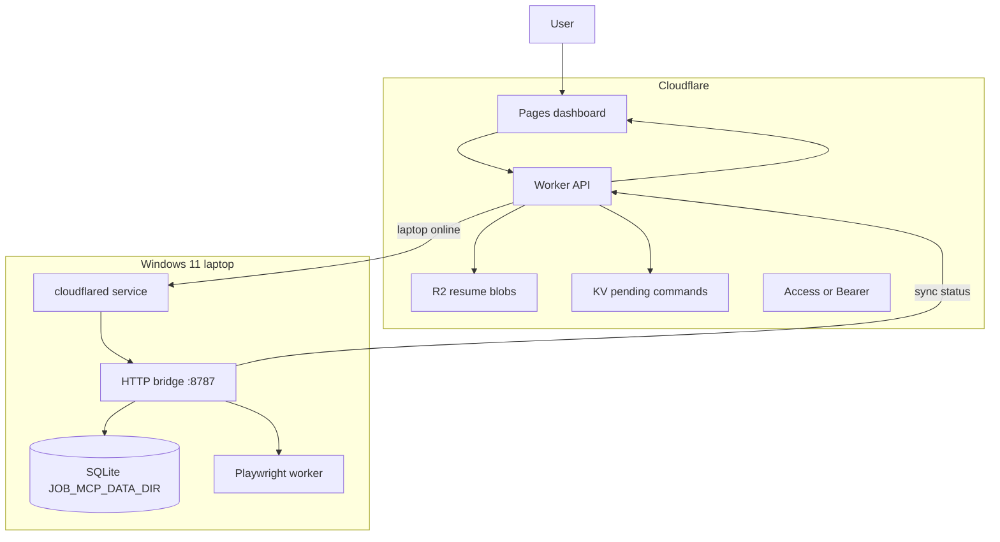

# Hybrid Cloudflare + local job application (architecture)

This document maps your **Cloudflare dashboard + laptop executor** spec onto **job-application-mcp** without moving parsing, scraping, matching, or auto-apply to the edge.

## Objective (unchanged)

| Layer | Responsibility |
| --- | --- |
| **Cloudflare** | Web UI, resume upload, job list + scores, Apply clicks, status dashboard, **buffer when laptop is offline** |
| **Windows 11 laptop** | Parse CV, search/match (JobSpy, etc.), queue, Playwright auto-apply, SQLite source of truth |

**Constraint:** zero-drop resumes and apply intents; survive sleep, tunnel drops, and CAPTCHA pauses.

## What you already have (reuse — do not rewrite)

| Spec piece | Existing in this repo |
| --- | --- |
| Local API | HTTP bridge `src/http.ts` (`127.0.0.1:8787`, `POST /call`, bearer token) |
| Parse résumé | `parse_cv` (PDF/DOCX/TXT under `JOB_MCP_DATA_DIR`) |
| Job store + match | `analyze_job`, `match_cv`, `start_campaign` |
| Apply queue + states | `apply_queue` (`pending` → `ready` → `applying` → `paused` / `done` / `failed`) |
| Auto-fill + submit (ATS) | `execute_autofill`, Playwright `desktop/runner/campaign-worker.mjs`, extension runner |
| Policy guard | `classifyApplyUrl` — no LinkedIn/Indeed apply automation in core |
| Discovery | `scripts/jobspy-import.mjs` (optional Python JobSpy) |
| Desktop golden path | Campaign wizard — [AUTO_APPLY_CAMPAIGN.md](./AUTO_APPLY_CAMPAIGN.md) |

**Recommendation:** extend the **Node/TypeScript bridge** on the laptop, not a parallel FastAPI stack, unless you need Python-only parsers on the same port.

## Target topology

### Ingress when laptop is asleep or tunnel down

1. User uploads PDF/DOCX on Pages → Worker writes object to **R2** (`incoming/{uploadId}/file`) and metadata to **KV** (`pending_uploads`).
2. User clicks **Apply** on a job row → Worker appends command to **KV** (`pending_apply:{jobId}`) or Durable Object queue (stronger ordering).
3. Laptop **sync loop** (inside bridge or a small `sync-worker.mjs`):
   - `GET /edge/pull` over tunnel → download new uploads to `data/incoming/`, call `parse_cv`, acknowledge in KV.
   - Pull apply commands → `enqueue_apply` / `start_campaign` locally.
   - `POST /edge/push` → job cards, queue status, match scores for Pages.

4. Worker always returns **202 Accepted** for ingest; Pages polls or uses SSE/WebSocket for status (Worker or Durable Object).

## Cloudflare components (new — not in repo yet)

### A. Pages (`portal/` or separate repo)

Three views (from your spec):

1. **Upload + profile preview** — show parsed fields returned from laptop (`get_profile`, `list_cvs` preview).
2. **Search results** — read-only list from laptop (`list_job_inbox` / custom `list_matched_jobs`); scores from existing match pipeline.
3. **Queue tracker** — mirror `list_apply_queue` statuses (`Queued` ≈ `ready`, `Applying`, `Applied` ≈ `done`, `Needs Manual Review` ≈ `paused`, `Failed`).

Auth: **Cloudflare Access** or shared **Bearer** (same pattern as `JOB_MCP_HTTP_TOKEN`).

### B. Worker + R2 + KV (zero-drop buffer)

| Store | Contents |
| --- | --- |
| **R2** | Raw resume bytes, optional redacted exports |
| **KV** | Upload metadata, pending apply payloads, last-sync cursor, laptop `last_seen` |

Do **not** run Playwright or JobSpy on Workers — only buffer and proxy.

### C. Tunnel (`cloudflared` on Windows)

- Public hostname: e.g. `api.jobs.yourdomain.com` → `http://127.0.0.1:8787`
- Install as Windows service (NSSM or `cloudflared service install`)
- Bridge keeps `JOB_MCP_HTTP_TOKEN`; Worker adds **second** token for edge→laptop calls if needed

### D. Laptop supervision

| Service | Role |
| --- | --- |
| `cloudflared` | Tunnel |
| HTTP bridge | `npm run serve:http` or Electron desktop (already forks bridge) |
| Playwright worker | On demand or after `start_campaign` |
| Optional sync agent | Polls Cloudflare Worker when tunnel is up |

Register for **auto-restart on boot** (Task Scheduler / NSSM).

## Local API additions (suggested endpoints on bridge)

These wrap existing MCP tools — no duplicate business logic:

| Endpoint | Behavior |
| --- | --- |
| `POST /edge/ingest-resume` | Save file under `data/incoming/`, `202` + id |
| `POST /edge/sync/pull` | Laptop fetches KV pending items (Worker implements) |
| `POST /edge/sync/push` | Laptop pushes jobs + queue snapshot JSON |
| `GET /health` | Already exists; add `tunnel_ok`, `last_sync` |

Long work stays **async**: ingest returns immediately; `parse_resume` / `search_jobs` / `auto_apply` run in the existing SQLite-backed queue (same as `apply_queue` + campaign worker).

## Fail-safe behaviors

| Failure | Behavior |
| --- | --- |
| Laptop sleep | R2/KV hold uploads and Apply clicks; sync on wake |
| Tunnel drop | Pages show “Local engine offline”; buffer on edge |
| CAPTCHA / login | `pause_for_human` + notification (desktop); status **Needs Manual Review** in UI |
| Mid-application crash | Queue item stays `applying`/`paused`; worker retries from `list_apply_queue` |
| Anti-bot | No stealth bypass in core; user completes step, resume queue |

## Security & privacy

- Résumés and applications remain on disk under `JOB_MCP_DATA_DIR` (laptop).
- R2 is a **transit buffer** — define retention (e.g. delete object after laptop ACK + 7 days).
- Encrypt R2 at rest (Cloudflare default); Access on Pages and Worker routes.
- Align with AGPL/local-first: **edge code open**; no requirement to use paid Cloudflare beyond what you choose.

## Implementation phases

| Phase | Deliverable |
| --- | --- |
| **0** | This doc + tunnel runbook (Windows 11) |
| **1** | Worker: upload → R2, list pending; Pages upload UI |
| **2** | Laptop `sync-agent` (pull uploads → `parse_cv`, push profile to Worker) |
| **3** | Pages job list + Apply → KV command; laptop `enqueue_apply` / `start_campaign` |
| **4** | Status sync (`list_apply_queue` → Pages tracker) |
| **5** | Hardening: DO queue, idempotency keys, retention policies |

**Parallel track:** merge [PR #13](https://github.com/firyomaefx/job-application-mcp/pull/13) for desktop campaign + Playwright hardening — laptop UX works **without** Cloudflare until Phase 1 ships.

## Decisions needed

1. **Hostname & Cloudflare account** — Pages + Worker + R2 in one account?
2. **Parser on laptop** — keep `parse_cv` (Node) vs add PyMuPDF sidecar (your spec mention was cut off).
3. **Sync direction** — laptop polls Worker (simpler, works through NAT) vs Worker pushes to tunnel (needs laptop always reachable).
4. **Single user vs multi-tenant** — one tunnel token vs per-user Access (affects KV key layout).

## Out of scope (per product rules)

- Running auto-apply or JobSpy **on Cloudflare Workers**
- LinkedIn/Indeed **apply** automation in core
- Gating free-core features behind a hosted paid API

---

*Spec received 2026-11-20; section D (local parser LLM) was truncated in the source message — confirm PyMuPDF-only vs local LLM enrichment before Phase 2.*